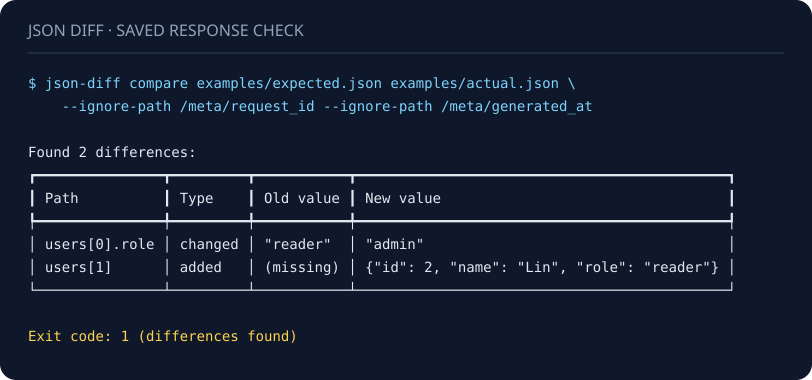

# JSON Diff

Compare saved API responses and JSON documents in your terminal or CI. Ignore volatile fields, keep a machine-readable diff, and generate an offline HTML report.

[简体中文](README.zh-CN.md) · [Examples](examples) · [Contributing](CONTRIBUTING.md)



Rendered from the bundled examples with [this script](docs/generate_demo.py). [Plain-text transcript](docs/demo.txt). Exit `1` means differences were found.

## Quick start

Python 3.8 or newer. Install **this repository** from source; the `json-diff` name on a package registry is not a verified distribution of this project.

```bash
git clone https://github.com/Master-626/json-diff.git
cd json-diff
python -m pip install .

json-diff compare examples/expected.json examples/actual.json \
  --ignore-path /meta/request_id \
  --ignore-path /meta/generated_at
```

The example finds two differences and exits **1**:

- `users[0].role`: `"reader"` → `"admin"`
- `users[1]`: added `{"id": 2, "name": "Lin", "role": "reader"}`

Change `examples/actual.json` to `examples/equivalent.json` in the command to get no differences and exit **0**. Whitespace and object-key order do not matter.

## A regression gate for saved responses

Capture responses separately, then compare local files. The tool does not fetch URLs, record requests, or send your data anywhere.

```bash
# JSON on stdout, including [] when equal. Differences still exit 1.
json-diff compare expected.json actual.json --json-output > diff.json

# Read one input from stdin. Use a saved file for the other input.
cat actual.json | json-diff compare expected.json - --ignore request_id

# Exit status only; errors are still written to stderr.
json-diff compare expected.json actual.json --quiet
```

`compare` exit codes:

| Code | Meaning |
| --- | --- |
| `0` | Equal under the selected ignore rules |
| `1` | Differences found |
| `2` | Invalid JSON, unreadable input, or usage error |

Malformed JSON, duplicate object keys, `NaN`, infinities and floating-point overflow are rejected rather than silently accepted. Input files use UTF-8; a leading UTF-8 BOM is accepted for files.

### Ignore exactly what is volatile

`--ignore NAME` skips that exact object-key name at every depth, including additions and removals. Repeat it to skip several names:

```bash
json-diff compare expected.json actual.json --ignore request_id --ignore generated_at
```

`--ignore-path POINTER` scopes the ignore to a location. Quote wildcard patterns to prevent shell expansion:

```bash
json-diff compare expected.json actual.json \
  --ignore-path /meta/request_id \
  --ignore-path '/users/*/last_seen'
```

- `/meta/request_id` does not ignore `/users/0/request_id`.
- A whole `*` segment matches exactly one object key or array index. It is not a recursive wildcard.
- Escape `/` in a key as `~1` and `~` as `~0`, following JSON Pointer. For example, `/a~1b` targets the key `a/b`.
- An empty pointer (`--ignore-path ''`) ignores the entire document. Use it with care.
- A literal key named `*` cannot be selected exactly by an ignore-path pattern. `--ignore '*'` ignores that key at every depth.
- Ignoring a container skips its entire subtree. Children are visited only when both sides are the same container type. A newly added, removed or type-changed container is reported as a whole, so a rule for only its child does not suppress the parent change.

**Ignore rules are comparison filters, not redaction.** Whole-container differences and reports may still contain sensitive values. Sanitize snapshots and review reports before sharing them or uploading CI artifacts.

### Machine-readable output

The output is a JSON array. Each difference has `path`, `pointer`, `type`, `old_value` and `new_value`:

```json
[
  {
    "path": "users[0].role",
    "pointer": "/users/0/role",
    "type": "changed",
    "old_value": "reader",
    "new_value": "admin"
  }
]
```

`pointer` is an RFC 6901 JSON Pointer, including `""` for the root. Use it in programs: display paths are meant for people. `type` is `added`, `removed` or `changed`. The absent side uses JSON `null`; distinguish an absent value from a real `null` using `type`.

This is a comparison report, **not** an RFC 6902 patch. The JSON and HTML formats retain full values; the terminal view truncates long values.

### Safe, offline HTML reports

```bash
json-diff report examples/expected.json examples/actual.json \
  --ignore-path /meta/request_id \
  --ignore-path /meta/generated_at \
  --output report.html --fail-on-diff
```

Input names, keys and values are escaped as text. Reports contain no JavaScript or external resources. Output is replaced atomically, and the command refuses to overwrite either input, including symlink or hard-link aliases.

`report` normally exits `0` after saving, even when differences exist. Add `--fail-on-diff` for exit `1` on differences, after the report is saved. Input, output and usage errors exit `2`. It accepts the same ignore options and one stdin input as `compare`.

## Use in GitHub Actions

After installing from your reviewed checkout and generating `expected.json` and `actual.json`, run:

```yaml
- name: Compare saved responses
  run: >-
    json-diff compare expected.json actual.json
    --ignore-path /meta/request_id
    --json-output > diff.json
```

A changed response fails the step. Do not add `|| true` to a regression gate: it also hides invalid input. If installing from Git in another repository, pin a reviewed commit rather than a moving branch. Upload reports only after checking whether they contain private data.

The repository's own [CI workflow](.github/workflows/ci.yml) runs tests, lint, packaging and an installed-wheel smoke test.

## Python API

```python
from json_diff.comparator import compare_json, load_json

diffs = compare_json(
    load_json("expected.json"),
    load_json("actual.json"),
    ignore_fields=["generated_at"],
    ignore_paths=["/meta/request_id"],
)
```

Pass JSON-compatible values. Comparison does not modify them. The optional legacy `path` argument prefixes display paths only; pointers always start at the compared document's root.

## Comparison rules and limits

- Object keys are visited in sorted order for stable output.
- Arrays are compared **by index**, with each added or removed tail element reported. Reordering, or inserting an element in the middle, can produce multiple differences. There is no ID-based matching or minimum-edit algorithm.
- Types are strict: `true`, `1` and `1.0` are distinct. Numbers use Python's JSON decoder, so decimal values use binary floating point. This is not an exact-decimal financial comparison tool.
- Inputs and results are held in memory. Files with more than 200 nested containers are rejected with an input error. There is no streaming mode, schema validation, tolerance option, patch application, or automatic compatibility assessment. A data difference is not necessarily a breaking API change.

For minimal array diffs or patch formats, see [jd](https://github.com/josephburnett/jd). For CSV/TSV or flat JSON rows matched by an ID, see [csv-diff](https://github.com/simonw/csv-diff). This project focuses on a small Python CLI for saved JSON regression checks.

## Development

```bash
python -m pip install -e '.[dev]'
python -m pytest --cov=json_diff --cov-report=term-missing
ruff check .
ruff format --check .
python -m build
```

See [CONTRIBUTING.md](CONTRIBUTING.md) for the test and bug-report workflow. Licensed under [MIT](LICENSE).
