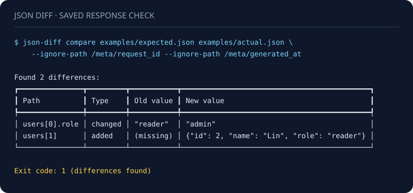

# JSON Diff

比较保存下来的 API 响应和 JSON 文件：过滤易变字段、输出机器可读的差异，并生成离线 HTML 报告。

[English / 完整文档](README.md) · [示例文件](examples) · [贡献指南](CONTRIBUTING.md)



演示由[生成脚本](docs/generate_demo.py)实际运行仓库示例后生成，并附[纯文本输出](docs/demo.txt)。退出码 `1` 表示发现差异。

## 快速使用

需要 Python 3.8 或更新版本。请从**本仓库源码**安装；我们没有验证软件包仓库中同名 `json-diff` 包属于这个项目。

```bash
git clone https://github.com/Master-626/json-diff.git
cd json-diff
python -m pip install .

json-diff compare examples/expected.json examples/actual.json \
  --ignore-path /meta/request_id \
  --ignore-path /meta/generated_at
```

示例会找出两处差异并返回退出码 `1`：

- `users[0].role` 从 `"reader"` 变成 `"admin"`。
- `users[1]` 新增了一个用户对象。

将命令里的 `examples/actual.json` 换成 `examples/equivalent.json`，结果应为无差异，退出码 `0`。

## 常用命令

```bash
# JSON 输出；相等时也输出合法 JSON：[]。
json-diff compare expected.json actual.json --json-output > diff.json

# 全局忽略同名字段，包括新增和删除。
json-diff compare expected.json actual.json --ignore generated_at

# 只忽略指定位置。* 匹配一层键名或数组下标，必须加引号。
json-diff compare expected.json actual.json --ignore-path '/users/*/last_seen'

# 第二个文件多出来的键或数组尾部元素不算失败；删除、改值和类型变化仍会报告。
json-diff compare expected.json actual.json --ignore-added

# 从标准输入读取其中一个文件。
cat actual.json | json-diff compare expected.json -

# 生成报告；保存后若有差异则返回 1。
json-diff report expected.json actual.json -o report.html --fail-on-diff
```

`compare` 的退出码：`0` 表示相等，`1` 表示有差异，`2` 表示输入或用法错误。报错写入 stderr。`report` 默认在成功保存后返回 `0`；添加 `--fail-on-diff` 才会对差异返回 `1`。

`--ignore-added` 适合“实际响应可以多字段”的兼容性检查。数组仍按下标比较，在中间插入元素时，后面的下标仍会报差异。标准输入和文件一样接受开头的 UTF-8 BOM。

JSON 输出中的 `pointer` 是 RFC 6901 JSON Pointer，可准确区分含点号、斜杠等字符的键名。根节点的 pointer 是空字符串。忽略路径中的 `/` 和 `~` 分别编码为 `~1` 和 `~0`。

## 精确小数比较

两个命令均支持显式开启 `--exact-decimals`：

```bash
json-diff compare expected.json actual.json --exact-decimals --json-output
json-diff report expected.json actual.json --exact-decimals -o report.html --fail-on-diff
```

该模式用 Python `Decimal` 精确读取带小数点或指数的数值，可识别 `0.10000000000000000` 与 `0.10000000000000001`、`1e-400` 与 `0.0` 的差异；默认二进制浮点模式会将这两组分别视为相等。精确模式也接受 `1e400` 等有限数，但受平台 Decimal 指数范围限制，超出范围返回输入错误（退出码 `2`）。

- 整数与小数仍区分：`1` 与 `1.0`、`1` 与 `1e0` 均不同。`1.0`、`1.00`、`1e0` 数值相等，小数正负零也相等，不比较原始写法或末尾零的数量。
- JSON 和 HTML 保留完整数值，包括整个容器的新增或删除。JSON 输出仍是数值，不转成字符串，并保留小数点或指数以区分整数。
- 为兼容现有调用，默认仍使用二进制浮点数。已经转成 float 的数据无法恢复丢失的数字；该功能不提供容差、金额舍入或财务校验。
- 读取差异报告时也需使用精确解析器，例如 Python 的 `json.loads(text, parse_float=Decimal)`。JavaScript `Number` 或 Python `float` 仍可能再次丢失精度。

Python API 可在两次 `load_json` 或 `load_json_stream` 调用中都传入 `exact_decimals=True`。输出包含 Decimal 时，使用 `json_diff.serialization.dumps_json(diffs, indent=2)`，不要转成 float 或通过 `default=str` 把数值变成字符串。手动传入的 float 与 Decimal 仍按不同类型处理。

## 使用边界

- 数组按下标比较，新增和删除尾部元素会单独报告；不支持按 ID 对齐或最小编辑距离。
- 类型严格：`true`、`1`、`1.0` 互不相同。默认小数使用 Python 二进制浮点数；精确模式需显式开启。
- 拒绝重复键、非法 JSON 和非有限数；默认模式还拒绝浮点数溢出。文件和标准输入使用 UTF-8，开头的 UTF-8 BOM 会被接受。`compare_json` 在实际比较或写入结果时也会拒绝 `NaN` 和无穷大；被忽略的字段不会检查。
- 忽略一个容器会跳过其子树；整个容器新增、删除或类型改变时，会报告完整容器，子字段的忽略规则不会取消父节点变化。
- 忽略规则不是脱敏工具。报告可能包含敏感数据，分享或上传 CI 附件前请检查。
- 报告中的文件名、键和值会转义，不包含脚本或外部资源；禁止覆盖输入文件。
- 工具只读取本地文件或标准输入，不发送网络请求；不提供 schema 校验、补丁应用或 API 兼容性判定。数据有差异不一定意味着接口不兼容。
- 全部数据保存在内存中，不是流式处理器；输入文件最多允许 200 层嵌套容器。完整规则、限制和 Python API 见[英文文档](README.md)。

开发验证：

```bash
python -m pip install -e '.[dev]'
python -m pytest --cov=json_diff --cov-report=term-missing
ruff check .
ruff format --check .
python -m build
```

[MIT 许可证](LICENSE)。
